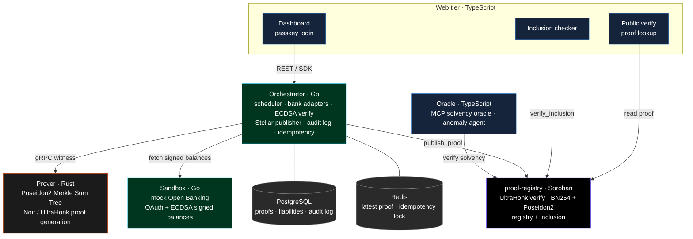

[](https://github.com/jes-labs/solva/actions/workflows/ci.yml)
[](./LICENSE)

[](https://stellar.org)
[](https://noir-lang.org)
[](https://www.rust-lang.org)
[](https://go.dev)
[](https://www.typescriptlang.org)
[](https://nextjs.org)
[](https://grpc.io)
[](https://www.postgresql.org)


Solva is a zero-knowledge Proof of Reserves protocol on Stellar. It lets a custodial institution prove that its reserves are greater than or equal to its liabilities, continuously and without revealing any customer balance.

A normal audit samples a few accounts, takes weeks, and ships a report that is already stale. Solva replaces that with a proof. Reserves are attested at the source through signed bank balances or on-chain holdings. Liabilities are committed into a Poseidon2 Merkle Sum Tree. A Noir circuit proves the relation `R >= L`, and a Soroban contract verifies the proof on-chain using the BN254 and Poseidon2 host functions added in Stellar Protocol 25 and 26.

The proof reveals nothing about who owns what. The public sees only the totals and the commitment root. Regulators can be given a viewing key for selective disclosure, and customers can check that their own balance is included in the committed tree.

**Live demo:** run the full flow on Stellar Testnet at **[joinsolva.xyz/sandbox](https://www.joinsolva.xyz/sandbox)** — connect a mock bank, generate a zero-knowledge proof, publish it on-chain, and check a customer's inclusion.

**Demo video:** [watch the walkthrough](https://www.youtube.com/watch?v=fDMml7nLFHU).

## Why both sides of the balance sheet

Proving that you hold assets is not the same as proving you are solvent. A reserve figure can look healthy while the liabilities owed to customers are larger.

```
Proof of Solvency = Proof of Reserves + Proof of Liabilities
```

Most published proof of reserves systems only attest the asset side. Solva binds both sides in one proof, so the reserve total cannot hide a larger liability total.

## Architecture

Each tier uses the language that fits it. The system holds together through crypto isolation: every hash that must match the circuit lives only in the Rust prover and the Soroban contract, and the Go orchestrator never hashes for the circuit. The Merkle Sum Tree is built once, in the Rust stack that generates the proof, and recomputed on-chain by the native Poseidon2 host function. This rules out a parameter mismatch between languages.



Postgres stores proofs, liabilities, and the audit log. Redis caches the latest proof and holds the per-cycle idempotency lock.

| Tier | Language | Role |
|------|----------|------|
| Circuits | Noir | Solvency, Merkle Sum, and fraud-bound constraints |
| Prover | Rust | Poseidon2 tree construction and UltraHonk proof generation |
| Contract | Rust / Soroban | On-chain proof verification, registry, inclusion check |
| Orchestrator | Go | Scheduling, bank IO, ECDSA verification, publishing, REST |
| Sandbox | Go | Mock Open Banking with OAuth and signed balances |
| Web and oracle | TypeScript | Next.js app, docs, MCP oracle, anomaly agent, SDK |

## How a proof cycle works

1. The orchestrator fetches signed reserve balances from each source and verifies the ECDSA signatures.
2. It loads the customer liabilities for the tenant from Postgres.
3. It sends reserves, liabilities, and the previous reserve total to the prover over gRPC.
4. The prover builds the Poseidon2 Merkle Sum Tree, generates the Noir/UltraHonk proof, and returns the proof, the public inputs, and the serialized tree.
5. The orchestrator publishes the proof to the Soroban `proof-registry` contract, which verifies it on-chain and stores the root and totals.
6. The proof and tree are persisted to an append-only audit log. The latest proof is cached in Redis.
7. The web app reads the latest proof, customers check inclusion on-chain, and the oracle answers solvency queries.

## What is real, and what is simulated

Solva's cryptographic core is real and runs on Stellar Testnet today: the Noir circuit, the UltraHonk prover, and the Soroban contract that verifies the proof on-chain and stores the result. The `/sandbox` demo generates real proofs and publishes them to Testnet, and each institution publishes to its own contract.

To make that runnable without a real bank, the reserve data comes from a **mock Open Banking sandbox**: a Go service that returns ECDSA-signed balances, standing in for the signed Open Banking feeds or on-chain holdings a production institution would connect. The signatures are real and verified by the orchestrator; only the balance figures are synthetic. The sandbox simulates the reserve-attestation step, not the cryptography.

The operator console (`apps/web`) is partly illustrative: the passkey wallet, publishing, and tenant provisioning call the real services, while the main dashboard's cycle history and connect-source views use mock data. Real Open Banking and on-chain reserve integration, and a production-data console, are future work.

## Passkey smart wallet

Institutions do not hold private keys. An operator signs in with a passkey, and that passkey controls a Soroban smart wallet that owns the institution's proof registry. Publishing is owner-gated through `owner.require_auth()`, so every proof is authorized by the wallet. For continuous publishing, the operator grants the orchestrator's Ed25519 key as a signer scoped to that one registry, so the service can publish and nothing else. The passkey stays the root of authority and can revoke that signer at any time. The full model is in the [passkey smart wallet](apps/docs/content/docs/passkey-wallet.mdx) page.

## Repository layout

```
apps/        web (product app), website (marketing site), docs (Fumadocs)
services/    orchestrator (Go), prover (Rust), sandbox (Go), oracle (TypeScript)
circuits/    Noir circuits: solvency, merkle, shared lib
contracts/   Soroban proof-registry
packages/    sdk-ts, contract-bindings, shared-types, ui, brand, config
proto/       gRPC definitions for orchestrator and prover
infra/       docker-compose for Postgres and Redis
```

This is a polyglot monorepo. The proof schema, contract bindings, and shared types must stay in lockstep across the verifier, prover, orchestrator, SDK, and web app. Keeping them in one repository makes any change to them a single atomic commit.

## Running it locally

Everything runs against Stellar Testnet on your machine.

### Prerequisites

Install the tools below. Two of them are **version-sensitive**: `bb` and `nargo`
must be the exact pinned versions, or proofs will not verify. Rust (1.91.1 +
`wasm32v1-none`) and pnpm are pinned in the repo (`rust-toolchain.toml`,
`packageManager`), so those resolve automatically once the tool is installed.

On **Windows**, use **WSL2** (Ubuntu) and follow the Linux steps.

#### Installation guides

**Docker** — runs Postgres and Redis.
- macOS: [Docker Desktop](https://www.docker.com/products/docker-desktop/), or `brew install --cask docker`
- Linux: `curl -fsSL https://get.docker.com | sh` ([docs](https://docs.docker.com/engine/install/))

**Node 22 + pnpm** — web tier and SDK.
```bash
# Node 22 via nvm (https://github.com/nvm-sh/nvm)
nvm install 22 && nvm use 22
# pnpm via corepack (picks up the version pinned in package.json)
corepack enable
```

**Go 1.25** — orchestrator and sandbox.
- macOS: `brew install go`
- Linux: follow https://go.dev/doc/install

**Rust 1.91.1** — prover and Soroban contract. `rust-toolchain.toml` pins the
version and the `wasm32v1-none` target, so rustup installs them for you.
```bash
curl --proto '=https' --tlsv1.2 -sSf https://sh.rustup.rs | sh
```

**Stellar CLI** — deploys and reads contracts.
```bash
brew install stellar-cli        # macOS / Linux with Homebrew
# or: cargo install --locked stellar-cli
```
[Install docs](https://developers.stellar.org/docs/tools/cli/install-cli)

**Noir `nargo` 1.0.0-beta.9** — the circuit toolchain.
```bash
curl -L https://raw.githubusercontent.com/noir-lang/noirup/main/install | bash
noirup --version 1.0.0-beta.9
```

**Barretenberg `bb` 0.87.0** — the proving backend. Pick the build for your OS
and CPU from the [v0.87.0 release](https://github.com/AztecProtocol/aztec-packages/releases/tag/v0.87.0):
```bash
mkdir -p ~/.bb
# Apple Silicon (arm64 Mac):
curl -L https://github.com/AztecProtocol/aztec-packages/releases/download/v0.87.0/barretenberg-arm64-darwin.tar.gz | tar -xzC ~/.bb
# Intel Mac:  barretenberg-amd64-darwin.tar.gz
# Linux:      barretenberg-amd64-linux.tar.gz
echo 'export PATH="$HOME/.bb:$PATH"' >> ~/.zshrc   # or ~/.bashrc
source ~/.zshrc
```

**Just** — the command runner.
```bash
brew install just               # macOS / Linux with Homebrew
# or: cargo install just
```

**Verify everything is installed and on PATH:**
```bash
docker --version && node --version && pnpm --version && go version \
  && rustc --version && stellar --version && nargo --version \
  && bb --version && just --version
```
`bb --version` must print `0.87.0` and `nargo --version` `1.0.0-beta.9`.

Then install dependencies and create a funded Testnet identity that signs and publishes proofs:

```bash
pnpm install
stellar keys generate tester --network testnet --fund
```

**Docker must be running** for both options below: the sandbox, prover, and orchestrator run locally, and Postgres and Redis start in containers.

### Option A: the full pipeline in one command

Runs attestation through on-chain verification across all three scenarios:

```bash
export E2E_STELLAR_SIGNER_SECRET=$(stellar keys show tester)
just e2e
```

It deploys the registry, starts the sandbox, prover, and orchestrator, fetches signed reserves, generates the Noir/UltraHonk proof, publishes it to the Soroban contract, and verifies it on-chain. It ends with `E2E PASSED`: the solvent and near-breach proofs are published and verified, and the insolvent case is refused (the system will not prove a lie).

### Option B: the interactive playground

Bring up the stack with two seeded institutions, each with its own on-chain registry:

```bash
export ORCH_STELLAR_SIGNER_SECRET=$(stellar keys show tester)
just demo
```

Then, in a second terminal, start the website against it:

```bash
ORCHESTRATOR_URL=http://localhost:8080 SANDBOX_URL=http://localhost:8090 \
  pnpm --filter @solva/website dev
```

Open `http://localhost:3000/sandbox`, connect the mock bank, and run a cycle. Try the three scenarios: `solvent` and `near-breach` publish a proof, `insolvent` is refused on-chain. You can also check a customer's inclusion against the published proof, and open the transaction on the public explorer.

### Other commands

- `just --list` shows every target.
- `just test` runs the test suites.
- `just parity-check` confirms the circuit, prover, and contract compute the same Poseidon2 commitment.
- `just e2e-multitenant` proves two institutions stay isolated on-chain (export `E2E_STELLAR_SIGNER_SECRET` first, as in Option A).

The contributor workflow is in [CONTRIBUTING.md](./CONTRIBUTING.md), and the engineering standards are in [SKILL.md](./SKILL.md).

## Documentation

Protocol overview, quickstart, SDK reference, and the sandbox guide live in [Docs](https://docs.joinsolva.xyz/). The cryptographic construction and the formal algorithm are in the [whitepaper](https://drive.google.com/file/d/1Dw3cdqTik4GZSMxB1Wckv230VRGUq538/view).

## Project status

Built for the Stellar Real-World ZK hackathon. Running on Stellar Testnet today: the Noir/UltraHonk proving pipeline, the Soroban on-chain verifier, per-institution multi-tenancy, and passkey smart-wallet publishing. Try it at [joinsolva.xyz/sandbox](https://www.joinsolva.xyz/sandbox). The reserve source in the demo is a mock Open Banking sandbox, described above in "What is real, and what is simulated". Next: real Open Banking and on-chain reserve integration, a production-data console, a security audit, and Mainnet. Open work is tracked in the [issues](https://github.com/jes-labs/solva/issues).

## Contact

Questions, partnerships, or press: [support@joinsolva.xyz](mailto:support@joinsolva.xyz).

## License

Apache-2.0. See [LICENSE](./LICENSE).
